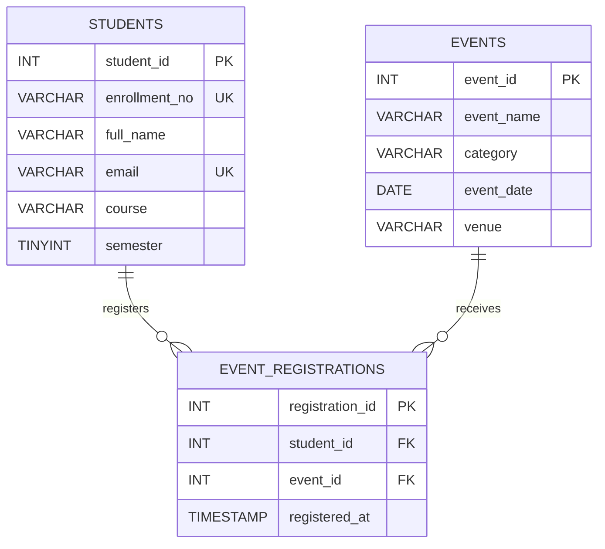

# StudentHub ER Model (Practical 8)

Relationship: Student (1) -> (many) Registrations; Event (1) -> (many) Registrations.
The registrations junction table resolves the many-to-many relationship between students and events.

**Normalization (3NF):** Each table stores one entity/relation. All columns contain atomic values (1NF); no partial dependencies (2NF); non-key attributes do not depend on other non-key attributes (3NF). The junction table has a unique `(student_id,event_id)` pair to prevent duplicate registration. Foreign keys enforce referential integrity.

**Security:** PDO prepared statements for user-submitted registration, exception error handling, escaped HTML output, CSRF token, server-side integer validation and environment-variable credentials.
